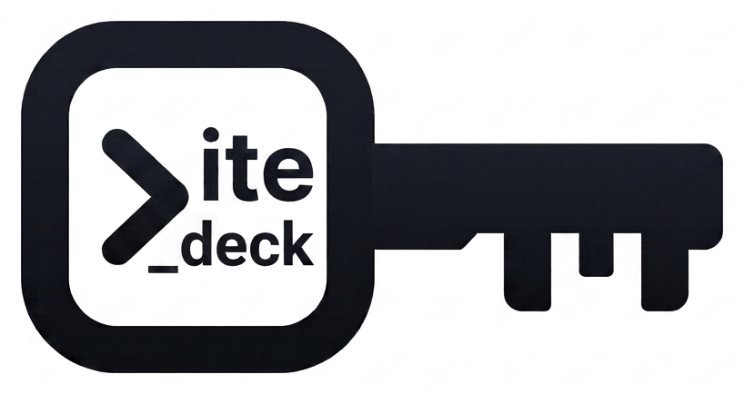
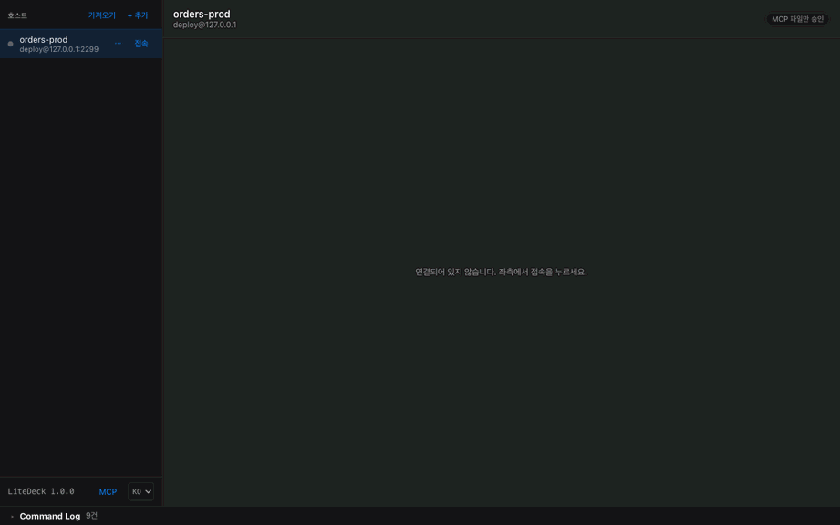
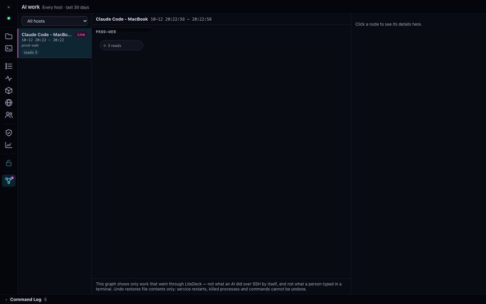

<p align="center">
  <picture>
    <source media="(prefers-color-scheme: dark)" srcset="docs/logo-dark.png">
    
  </picture>
</p>

<h1 align="center">LiteDeck</h1>

<p align="center">
  <b>SSH로 접속한 서버를 한 화면에서 관리하는 데스크톱 앱</b><br>
  서버에는 아무것도 설치하지 않습니다
</p>

<p align="center">
  <a href="https://github.com/cpprhtn/LiteDeck/actions/workflows/ci.yml"></a>
  <a href="https://github.com/cpprhtn/LiteDeck/releases"></a>
  <a href="LICENSE"></a>
  
</p>

<p align="center">
  <a href="README.md">English</a> · <b>한국어</b>
</p>

<p align="center">
  <a href="#설치와-첫-연결">다운로드</a> ·
  <a href="docs/features.md">기능</a> ·
  <a href="docs/security.md">보안</a> ·
  <a href="docs/mcp.md">MCP 연동</a> ·
  <a href="docs/support.md">지원 범위</a> ·
  <a href="CONTRIBUTING.md">기여하기</a>
</p>

<p align="center">
  
</p>

<p align="center">
  <sub>접속 한 번으로 <b>파일 · 편집기 · 서비스 · 프로세스 · 컨테이너 · 네트워크 · 세션 · 모니터링 · 터미널</b>까지.<br>
  서버에는 아무것도 설치하지 않았습니다.</sub>
</p>

---

## 무엇을 할 수 있나

SSH로 서버에 한 번 접속하면, 아래 작업을 같은 창에서 이어서 할 수 있습니다.

| | |
|---|---|
| **파일** | 탐색·업로드·다운로드, 폴더째 전송. 전송이 끊기면 이어받습니다 |
| **편집** | 문법 강조 편집기. 저장하기 전에 서버에 있는 내용과의 차이를 보여 줍니다 |
| **서비스 · 프로세스 · 컨테이너** | systemd 유닛과 Windows 서비스, 작업 관리자식 프로세스 표, Docker·Podman 컨테이너와 Compose 프로젝트 |
| **모니터링** | CPU·메모리·디스크·네트워크, NVIDIA GPU, 시간에 따른 추세와 시스템 이벤트 |
| **보안 · 세션** | 방화벽과 fail2ban 상태, 지금 접속해 있는 사람, 접속 실패 요약 |
| **터미널** | 탭·화면 나누기·테마·글꼴을 고를 수 있는 내장 터미널. `vi nginx.conf`처럼 파일을 여는 명령은 앱의 편집기에서 엽니다 |
| **AI 작업** | MCP 클라이언트가 LiteDeck을 거쳐 서버에서 한 일을 세션별 그래프로. 바뀐 파일은 되돌릴 수 있게 |
| **설정 동기화** <sub>v2.3.0</sub> | 호스트 목록과 승인 정책을 암호화된 파일 하나로 내보내 다른 PC로 옮깁니다 |

전체 목록과 자세한 설명은 [기능 문서](docs/features.md)에 있습니다.

**앱 화면은 한국어와 영어를 지원합니다.** 운영체제 언어로 시작하고, 사이드바 아래 `KO` / `EN` 으로 바꿉니다.

## 왜 LiteDeck인가

1. **서버에 설치할 것이 없습니다.** 에이전트·데몬·패키지가 필요 없고, 이미 열려 있는 SSH 포트 하나로 동작합니다. 서버에는 사용자가 한 작업의 결과만 남습니다
2. **실행한 명령을 그대로 보여 줍니다.** 화면에서 한 작업은 전부 Command Log에 실제 명령으로 남습니다. 관리자 권한(sudo)이 필요하면 임의로 붙이지 않고 먼저 묻습니다
3. **가입할 계정이 없습니다.** 사용 정보를 수집하지 않고, 전체 소스가 공개돼 있습니다
4. **가볍습니다.** Electron을 쓰지 않습니다. Windows 기준 내려받는 파일 약 6MB, 설치 후 약 17MB이고, 1초 안에 실행됩니다 (크기는 v2.4.0 실측. macOS 판은 Intel·Apple Silicon 공용이라 12MB · 30MB)

## MCP 연동 — AI에게 서버 일을 맡기기

<p align="center">
  
</p>

<p align="center">
  <sub>에이전트가 nginx 설정을 고치고 nginx 를 재시작합니다. 호출할 때마다 노드가 생기고,<br>
  바뀐 내용을 diff 로 보고 한 번에 되돌립니다.</sub>
</p>

**AI가 서버에서 마음껏 일하게 두세요. 무엇을 했는지는 그래프로 보이고, 바뀐 파일은 되돌릴 수 있습니다.**

Claude Code·Codex 같은 MCP 클라이언트가 LiteDeck을 통해 서버를 조회하고 바꿉니다. 화면과 **같은 SSH
연결**을 쓰고, **같은 Command Log**에 남고, 서버에는 여전히 아무것도 설치하지 않습니다.

- **무엇을 했는지 봅니다.** AI 작업 화면이 세션마다 그래프를 그립니다 — 호스트마다 가로 띠, 왼쪽에서
  오른쪽이 시간, 파일 변경은 그 파일이 속한 서비스의 재시작과 이어집니다. 클라이언트마다 토큰을 따로
  주면 어느 쪽이 한 일인지도 남습니다
- **파일을 되돌립니다.** AI가 파일을 덮어쓰거나 지우기 전에 이전 내용을 이 컴퓨터에 둡니다(기본 7일).
  변경 하나씩, 또는 세션의 파일 변경 전부를 최신 것부터 되돌립니다. 그 사이 다른 변경이 있었던 파일은
  건너뛰고 알려 줍니다
- **있던 안전장치는 그대로입니다.** 파일을 바꾸기 전에는 기본적으로 diff 를 보여 주고 확인을 받습니다.
  서버별로 「모든 변경 확인」이나 몇 시간 「묻지 않기」로 바꿀 수 있습니다. 명령 실행과 파일 삭제는
  따로 켜는 스위치이고 기본은 꺼짐입니다. 어느 것도 AI 클라이언트 쪽에서는 바꿀 수 없습니다
- **보이지 않는 것, 되돌릴 수 없는 것.** 그래프에는 LiteDeck을 거친 작업만 나옵니다 — AI가 SSH로 직접
  한 일, 터미널에서 직접 친 명령은 없습니다. 되돌리기는 파일 내용만 됩니다. 재시작·프로세스 종료·명령의
  효과는 그대로 남습니다

```bash
claude mcp add --transport http litedeck http://127.0.0.1:<포트>/mcp \
  --header "Authorization: Bearer <토큰>"
```

→ [MCP 연동](docs/mcp.md) — 도구 18개, 승인 모드, 그래프와 그 한계

## 설치와 첫 연결

[릴리스 페이지](https://github.com/cpprhtn/LiteDeck/releases)에서 받으세요.

| 파일 | 대상 |
|---|---|
| `litedeck-desktop-macos.zip` | macOS (Intel·Apple Silicon 공용) |
| `litedeck-desktop-windows-amd64.zip` | Windows 10/11 (amd64). 압축을 풀면 `litedeck.exe` 하나이고, 설치 없이 바로 실행합니다 |
| `litedeck-desktop-linux-amd64.tar.gz` | Linux (amd64). **Ubuntu 24.04 이상** — `libwebkit2gtk-4.1`이 필요합니다. 22.04라면 [직접 빌드](docs/building.md)하세요 |

> [!WARNING]
> **현재 릴리스는 코드 서명이 되어 있지 않습니다.** 서명·공증에는 비용이 들어 초기에는 미서명으로 배포하며,
> 함께 올리는 SHA256 체크섬은 **서명을 대신하지 못합니다.** 신뢰가 필요하면
> [직접 빌드](docs/building.md)하세요.
>
> 그래서 첫 실행 때 macOS Gatekeeper와 Windows SmartScreen 경고가 뜹니다. 넘어가는 방법은
> [설치와 서버 준비](docs/install.md)에 적어 두었습니다.

**첫 연결**

1. 앱을 열고 왼쪽 위의 **+ 추가**를 누릅니다. `~/.ssh/config`를 쓰고 있다면 **가져오기**로 한 번에 불러올 수 있습니다
2. 주소·사용자·인증 방식(SSH 에이전트 · 키 파일 · 비밀번호)을 입력합니다
3. 처음 접속하는 서버는 호스트 키 지문을 확인하라고 묻습니다. 확인하면 서버의 탭들이 열립니다

**서버 쪽 준비.** Linux 서버라면 이미 SSH로 접속하고 계실 테니 준비할 것이 없습니다. Windows는 OpenSSH 서버만 켜면 됩니다.
집에 있는 PC를 외부에서 다루려면 포트포워딩 대신 메시 VPN을 권합니다 —
[서버 준비](docs/install.md#서버-준비) · [Tailscale로 외부에서 쓰기](docs/remote-access.md)

**웹 브라우저로 쓰기 — 서버 모드.** 데스크톱 앱 대신, 서버 한 대에 LiteDeck을 올려 두고 웹 브라우저로
접속해 쓸 수도 있습니다 — `litedeck-server-linux-amd64.tar.gz` · `litedeck-server-linux-arm64.tar.gz`.
이 경우에는 LiteDeck이 웹 서버로 동작하고 로그인 화면이 있습니다. 실행·노출·로그인 설정은
[서버 모드](docs/server-mode.md)에 적어 두었습니다.

## 지원 환경

> [!NOTE]
> **macOS · Windows · Ubuntu에서 실행을 확인했습니다.** 어느 환경에서 무엇까지 확인했는지는
> [지원 범위](docs/support.md)에 적어 두었습니다.
> 삭제·프로세스 종료처럼 되돌릴 수 없는 작업은 시험용 서버에서 먼저 해 보세요.

- **관리할 서버**: systemd를 쓰는 Linux(Ubuntu·Debian·라즈베리파이 등)와 Windows(OpenSSH 서버).
  Windows 서버는 세션·보안 탭까지 지원하며, 이벤트 탭은 아직 없습니다
- **앱을 실행할 PC**: macOS · Windows 10/11 · Linux(Ubuntu 24.04 이상)

**이런 환경에 맞습니다**

- 서버 두세 대에서 대여섯 대 정도를 직접 운영합니다. 로그를 보고, 서비스를 재시작하고, 설정 파일을 고칩니다
- 그 서버에 다른 프로그램을 더 설치하고 싶지 않습니다. 이미 열려 있는 SSH로 충분하길 바랍니다
- GUI를 쓰더라도, 무엇이 실행됐는지는 확인하고 싶습니다
- 터미널을 버릴 생각은 없고, 자주 하는 일만 클릭으로 하고 싶습니다

서버 수십 대를 한꺼번에 다루거나, 선언적 상태 관리나 본격적인 원격 개발 환경이 필요하다면 다른 도구가 낫습니다.
어떤 경우인지는 [LiteDeck이 적합하지 않은 환경](docs/support.md#litedeck이-적합하지-않은-환경)에 적어 두었습니다.

## 더 읽어보기

| | |
|---|---|
| [보안](docs/security.md) | 호스트 키 검증·인증·자격증명 저장·sudo·MCP 엔드포인트. **못 하는 것을 먼저** 적었습니다 |
| [지원 범위](docs/support.md) | 무엇을 어디서 검증했고 무엇이 미검증인지. 적합하지 않은 환경과 지원하지 않는 기능 |
| [MCP 연동](docs/mcp.md) | 도구 18개, 승인 정책, AI 작업 그래프, 되돌리기, 안전장치 |
| [기능 자세히](docs/features.md) | **전체 기능 목록**, 그리고 Command Log·편집기·전송·Compose·sshd 점검·ProxyJump |
| [설치와 서버 준비](docs/install.md) | 첫 실행 경고 넘기기, Windows OpenSSH 켜기 |
| [Tailscale로 외부에서 쓰기](docs/remote-access.md) | 포트포워딩 없이 집 PC에 접속하기. Tailscale SSH·MCP·서브넷 라우터, 그리고 계정 없이 가는 길 |
| [소스에서 빌드](docs/building.md) | 빌드와 테스트 |

## 기여

[CONTRIBUTING.md](CONTRIBUTING.md)를 참고하세요. **새 서버 OS를 지원하는 일이 어댑터 하나 구현으로 끝나도록** 설계돼 있습니다. Windows 지원도 그렇게 붙었습니다. OpenRC(Alpine)·launchd(macOS)·FreeBSD가 비어 있습니다.

**PR 은 `dev` 브랜치로 보내 주세요** — `main` 은 릴리스 전용입니다.

취약점을 발견하셨다면 공개 이슈 대신 **cpprhtn@naver.com**으로 보내주세요.

## 라이선스

[Apache-2.0](LICENSE)
