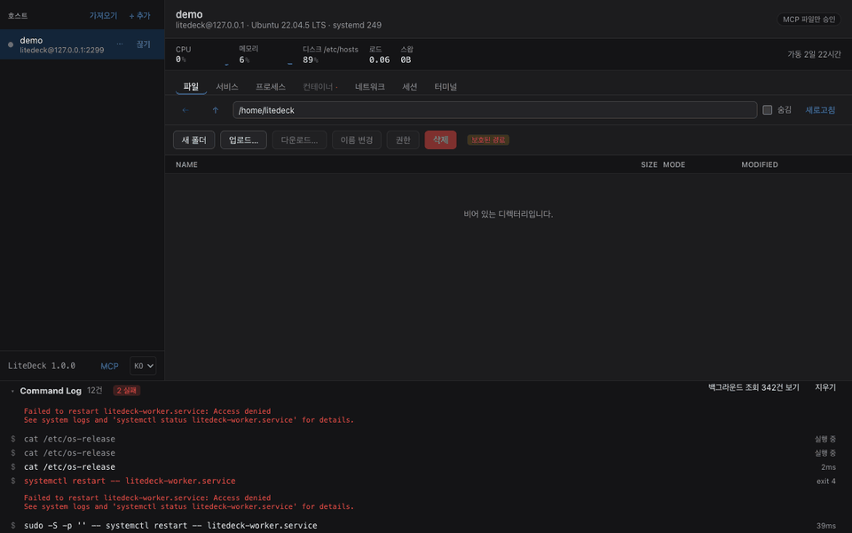

# MCP 연동

[← README](../README.ko.md)

<p align="center">
  
</p>

<p align="center"><sub>MCP 클라이언트가 파일을 고치려 하자 <b>서버의 현재 내용 대비 diff</b>가 뜹니다. 승인한 것은 되돌릴 수 있습니다.</sub></p>


Claude Code·Claude Desktop 같은 MCP 클라이언트가 이 앱을 통해 서버를 **조회하고 바꿉니다.**
사이드바 아래 **MCP** 버튼에서 켭니다.

> [!IMPORTANT]
> **파일을 바꾸거나 명령을 실행할 때는 기본적으로 물어봅니다.** 승인창에는 파일 diff 나 실행될
> 명령이 뜹니다. 서비스·컨테이너·프로세스 쪽 승인창의 명령줄은 **무엇을 하려는지 사람이 읽으라고
> 만든 요약**이지 실제 argv 가 아닙니다 — 윈도우나 podman 에서는 다른 명령이 실행됩니다. 그대로인
> 것은 파일 diff 와 `run_command` 의 명령줄입니다. 그 승인 정책은 **앱이 쥐고 있어 클라이언트
> 쪽에서는 못 바꿉니다.**

```
Claude Code  ──MCP(로컬 HTTP)──▶  LiteDeck  ──기존 SSH 연결──▶  서버
```

MCP 클라이언트는 **GUI와 동일한 어댑터, 이미 인증된 같은 SSH 연결, 같은 Command Log를
사용합니다.** 거기서 나온 명령은 `MCP` 표시로 흐릅니다.
서버 쪽에는 여전히 **아무것도 설치하지 않습니다.** Claude Code를 서버에 깔면
런타임과 상주 프로세스가 생기고, 컨텍스트 수집용 파일 탐색이 저사양 서버의 I/O를
때립니다. 그 부하는 전부 클라이언트가 집니다.

**조회 12개**: `hosts_list` · `health_snapshot` · `sys_stats` · `svc_list` · **`svc_logs`** ·
`proc_list` · `container_list` · **`container_logs`** · `net_ports` · `fs_list` · `fs_read` ·
`sessions_list`. `health_snapshot` 하나로 CPU·메모리·디스크·failed 유닛·비정상 컨테이너·
외부 노출 포트가 한 번에 오고, `svc_logs`가 **왜** 죽었는지를 말해줍니다.

Windows 서버에서는 경로를 `C:\Users\me\a.txt` · `C:/Users/me/a.txt` 어느 쪽으로 줘도 됩니다.

**변경 6개**: `svc_control`(시작/중지/재시작) · `container_control` · `proc_signal`(TERM/KILL) ·
`fs_write` · `fs_delete` · `run_command`.

**되돌릴 수 있습니다.** MCP가 파일을 덮어쓰거나 지우기 전에 이전 내용을 **이 컴퓨터에** 보관하고,
MCP 패널의 **변경된 파일** 탭이나 [AI 작업 화면](#ai-작업-화면)에서 되돌립니다. 묻지 않기로 두고
자리를 비웠을 때 방어 대신 남는 것이 이것입니다. **기본 7일 보관하고 알아서 지웁니다** — 기간(1–90일)과
최대 용량은 변경된 파일 탭에서 바꿉니다. 보관소가 아니라 지난주 작업 하나를 되돌릴 수 있게 하는 가드입니다.
서버에는 아무것도 남기지 않고, `fs_delete`는 사본을 못 남기면(바이너리·초대형) 아예 거부합니다.

**파일 삭제는 서버별로 따로 켭니다.** 읽기 공유·변경 승인과 별개인데, *도구가 존재하는가* 와
*쓸 때 물어보는가* 는 다른 질문이기 때문입니다. 꺼져 있는 서버에서 AI가 파일을 지우려 하면 그냥
거부하지 않고 **창을 띄워 묻습니다** — 지울 파일의 내용과 함께 「거부 / 이번만 허용 / 이 서버에서 계속
허용」. 명령 실행 스위치도 같습니다. 이 창은 「묻지 않기」 모드에서도 뜹니다. 묻지 않기는 허용된 변경을
묻지 않는다는 뜻이지, 꺼 둔 것을 켠다는 뜻이 아니기 때문입니다.

**명령 실행도 서버별로 따로 켭니다 — 기본은 꺼짐입니다.**
`run_command`는 `sh -c`로 한 줄을 실행하고 stdout·stderr·종료 코드를 돌려줍니다.
파일 삭제와 또 다른 스위치인데, 로그 파일 하나를 비우게 해 주는 것과 무엇이든 실행하게
해 주는 것은 같은 결정이 아니기 때문입니다.

이건 원래 「일부러 안 넣은 것」에 있었습니다. 뺀 이유는 셋입니다.

- **막고 있던 논거가 별도 스위치로 해소됩니다.** 반대 근거는 "임의 명령이 있으면 도구별 허용
  설정이 장식이 된다" 였는데, 그건 같은 스위치를 공유할 때만 참입니다
- **추적이 거꾸로였습니다.** 터미널 탭에서 친 명령은 Command Log에 **한 줄도 안 남습니다.**
  MCP를 지나면 도구 호출·실제 명령·종료 코드가 전부 남습니다. 실행을 막는 것이 감사를
  줄이고 있었습니다
- **경계가 이미 명목상이었습니다.** `fs_write`로 `~/.bashrc`나 `~/.ssh/authorized_keys`를
  쓸 수 있고, 그건 다음 접속에 임의 코드가 도는 것과 같습니다

**승인은 다른 변경 도구와 같은 모드를 따릅니다.** 기본(`파일 변경만 물어보기`)에서 명령은
**물어봅니다** — `svc_control(restart, nginx.service)`는 호출만 봐도 무엇이 벌어질지
정해지지만 셸 한 줄은 그렇지 않고, 승인창이 사람이 그 줄을 보는 유일한 자리입니다.
「8시간 동안 묻지 않기」를 켜면 **명령도 같이 통과합니다.**

처음에는 명령만 모드 바깥에 두어 항상 묻게 했는데, 그건 이 문서가 세워 둔 구분을 깬
것이었습니다 — *도구가 존재하는가* 는 토글이 답하고 *쓸 때 물어보는가* 는 모드가 답합니다.
게다가 무인 작업을 하라고 켜 둔 모드가 첫 명령에서 멈춰 서면 그 모드를 켠 의미가 없습니다.
되돌릴 수 없다는 사실은 `proc_signal`(KILL)이나 `svc_control`도 같고, 그쪽은 이미 모드가
관장합니다.

**되돌릴 수 없는 것은 그대로입니다.** 명령은 사본을 남기지 않으므로 「변경된 파일」 탭에
나타나지 않고, 승인창도 그렇게 말합니다. `run_command`에는 sudo가 없고, 달라고 할 방법도
없습니다: 로그인 사용자로 tty 없이 돌기 때문에 비밀번호를 원하는 명령은 기다리지 않고
실패합니다. 임의의 셸 줄이 root로 무엇을 할지는 무엇으로도 한정되지 않기 때문입니다.

## AI 작업 화면

> **AI가 서버에서 마음껏 일하게 두세요. 무엇을 했는지는 그래프로 보이고, 바뀐 파일은 되돌릴 수 있습니다.**

레일의 **AI 작업**을 누르면 MCP 클라이언트가 LiteDeck을 거쳐 한 일이 **세션별 그래프**로 나옵니다.
호스트별 화면이 아니라 전체 보기이고, 위쪽에서 호스트로 거를 수 있습니다. AI가 일하는 동안
열어 두면 노드가 생기는 대로 붙고, 레일의 점이 「지금 작업 중」을 알려 줍니다.
새로 생긴 제한은 없습니다 — 승인 모드·토글·sudo 자물쇠는 그대로이고, 이 화면은 보는 곳입니다.

- **왼쪽** — 세션 목록. 어느 클라이언트(토큰 이름), 어느 호스트, 시작·끝, 변경·실패·거부·조회 수
- **가운데** — 그래프. **호스트마다 가로 띠**, 띠 안에서 **대상마다 한 줄**, 왼쪽에서 오른쪽이
  시간 순서입니다. 같은 기록이면 늘 같은 그림이 나오고, 새 호출은 오른쪽에만 붙습니다
- **오른쪽** — 노드 상세. 파일이면 diff 와 되돌리기, 그 밖에는 실행된 명령 전문·결과·출력 앞부분

**선은 기록으로 확실히 알 수 있는 것만 긋습니다.**

| 선 | 규칙 |
|---|---|
| 같은 대상 | 같은 세션에서 같은 파일·서비스·컨테이너·프로세스를 다룬 호출을 시간 순으로 |
| 파일 → 서비스 | 파일을 바꾼 뒤 그 서비스를 재시작했으면. 대응표: `/etc/nginx/**`→nginx, `/etc/ssh/sshd_config*`→ssh·sshd, `/etc/apache2`·`httpd`·`caddy`·`haproxy`·`mysql`·`postgresql`·`redis`·`fail2ban`, `/etc/docker/daemon.json`→docker, `/etc/php/*/fpm`→php-fpm, 유닛 파일 → 그 유닛. **표에 없으면 잇지 않습니다** |
| 임의 명령 | **아무것과도 잇지 않습니다.** 셸 한 줄의 효과는 기록으로 알 수 없으니 시간 순서로만 놓습니다 |

조회는 기본으로 접혀 「조회 N건」 하나가 됩니다(두 번 누르거나 상세의 **펼치기**). 노드가 500개를
넘는 세션은 대상별로 묶어 그립니다. 색만으로 뜻을 전하지 않도록 실패·거부는 글자로도 붙습니다.

**되돌리기 상태**는 서버의 현재 파일을 AI가 쓴 직후의 해시와 비교해서 정합니다.

| 상태 | 뜻 |
|---|---|
| 되돌릴 수 있음 | 서버 파일이 AI가 쓴 그대로입니다 |
| 이후 다른 변경이 있었음 | 그 뒤에 다른 쓰기·사람·배포가 파일을 바꿨습니다. 되돌리면 그 변경도 사라지므로 한 번 더 묻습니다 |
| 스냅샷 만료 | 보관 기간이 지나 이전 내용이 없습니다 |
| 되돌림 | 이미 되돌렸습니다 |
| 연결 안 됨 | 호스트에 연결해야 비교할 수 있습니다 |

**세션 단위 되돌리기**는 그 세션의 파일 변경을 **최신 것부터** 되돌립니다. 같은 파일을 세 번 고쳤다면
세 번째, 두 번째, 첫 번째 순서로 처음 내용까지 돌아갑니다. 이후 다른 변경이 있었던 파일은 건너뛰고
(그 파일의 더 이른 변경도 함께) 목록으로 알려 줍니다. 세션에 되돌릴 수 없는 작업이 있으면 위에 개수가 뜹니다.

**기록은 Command Log 의 AI 줄에 붙습니다.** 그 줄들만 `ai-log.jsonl` 로 **30일** 이 컴퓨터에 남습니다
(0600). 사람이 앱에서 한 일은 지금처럼 메모리에만 있습니다.

> [!IMPORTANT]
> **이 그래프는 LiteDeck을 거친 작업만 보여줍니다.** AI가 SSH로 직접 한 일, 사람이 터미널에서 한 일은 없습니다.
> **되돌리기는 파일 내용만 됩니다.** 서비스 재시작, 프로세스 종료, 임의 명령의 효과는 되돌릴 수 없습니다.

## sudo

**좁은 도구 셋은 root로 돕니다 — 사용자가 잠금을 열어 둔 동안만입니다.** `svc_control` ·
`container_control` · `proc_signal` 이야기입니다.

비밀번호는 **LiteDeck에만 칩니다.** 보안 탭의 자물쇠를 열 때 한 번 치면 연결이 끝날 때까지
앱이 들고 있다가 `sudo -S`의 stdin으로 넘깁니다. 도구의 인자에도 응답에도 비밀번호가 들어갈
자리가 없고, **잠금을 여는 도구는 없습니다.** AI가 사람에게 비밀번호를 묻는 길을 만들지
않으려는 것입니다. 잠금이 닫혀 있으면 「LiteDeck에서 열어라」는 문장이 돌아옵니다.

**sudo라고 따로 묻지 않습니다.** 승인 정책을 그대로 따릅니다 — 「8시간 묻지 않기」를 켜 두었다면
sudo도 묻지 않습니다. 사람이 두 번 눌러 통과하는 관문은 두 개의 관문이 아닙니다.

**`fs_delete`는 제외입니다.** 다른 쓰기에는 롤백 사본이나 다시 켜면 되는 유닛이 뒤에 있지만
지운 파일에는 없습니다. Command Log에는 `sudo`가 붙은 명령줄이 그대로 남습니다.

**여전히 안 넣은 것**: 디렉터리 재귀 삭제, 컨테이너·이미지 삭제입니다. 사본을 남길 수 없어
되돌리기가 성립하지 않고, `run_command`와 달리 **좁은 도구라 오히려 안 물어볼 유혹이 큽니다.**

**안전장치**

| | |
|---|---|
| 서버별 opt-in | **기본 전부 꺼짐.** 호스트를 등록해도 MCP는 못 봅니다. 앱에서 켠 것만 읽힙니다. 파일 삭제와 명령 실행은 각각 또 따로 켭니다 |
| 명령 실행은 두 겹 | 서버별 토글이 **도구의 존재**를, 승인 모드가 **물어볼지**를 정합니다. 토글이 꺼져 있으면 어떤 모드에서도 실행되지 않고, 켜져 있어도 기본 모드는 매번 물어봅니다 |
| 변경 승인 | 기본은 **파일 변경과 명령 실행만 물어봄**. 승인창이 서버 현재 내용 대비 diff 나 실행될 명령을 보여주는데, 그건 클라이언트가 가질 수 없는 정보이기 때문입니다. 재시작 등 나머지 셋은 클라이언트가 이미 같은 걸 보여줬으므로 그냥 실행합니다 — **프롬프트가 아니라 Command Log 가 보장입니다** |
| 호스트별 조절 | 헤더의 배지에서 **전부 물어보기 / 파일만 / 8시간 동안 묻지 않기**. 통과 모드는 배지가 붉게 남고 **시간이 지나면 스스로 돌아옵니다.** 「전부 물어보기」는 만료가 없습니다 — 가장 보수적인 설정이 스스로 느슨해지면 안 됩니다 |
| 원격에서 못 바꿈 | 그 스위치를 켜는 도구도, 완화하는 파라미터도 없습니다. **모델이 자기 승인을 요청할 방법이 없습니다** |
| 읽기 ≠ 쓰기 | 읽으라고 공유해도 바꿀 수 있게 되지는 않습니다 |
| 바인딩 | `127.0.0.1` 전용. 외부 인터페이스로 여는 설정이 없습니다 |
| 인증 | Bearer 토큰. 설정에 저장되고, 재발급 버튼으로만 바뀝니다 |
| 레이트 리밋 | 초당 1.5회, 순간 8회. 에이전트 루프가 서버를 때리지 못하게 |
| 감사 | 모든 도구 호출이 Command Log에 남습니다. 로컬에만, 어디로도 안 갑니다 |

## 연결하기

MCP 패널의 **연결** 탭에서 클라이언트를 고르고 **복사** 를 누르면 됩니다. 붙여넣을 줄을 앱이 조립하므로 포트·토큰을 손으로 옮길 일이 없습니다.

**클라이언트마다 토큰을 따로 줄 수 있습니다.** **AI 클라이언트** 줄의 **클라이언트 추가**에
「Claude Code - 맥북」처럼 이름을 넣으면 그 클라이언트 전용 토큰과 붙여넣을 줄이 생깁니다. 이름은 AI 작업
기록에 **누가 했는지** 남기기 위한 것이고 **권한은 모두 같습니다.** 원래 토큰은 「기본」으로 그대로
동작하므로, 업데이트 후 아무것도 바꾸지 않아도 됩니다. 클라이언트를 삭제하면 그 토큰은 즉시 막힙니다.

**세션**은 클라이언트가 `Mcp-Session-Id` 를 유지하면(LiteDeck 이 `initialize` 응답에 발급합니다)
그 연결 단위로, 유지하지 않으면 같은 토큰의 호출이 **30분** 끊기면 새 세션으로 나눕니다.

| 클라이언트 | 상태 | 붙이는 법 |
|---|---|---|
| **Claude Code** | ✅ **실기 검증** | `claude mcp add --transport http …` 한 줄 |
| **Claude Desktop** | ⬜ 미검증 | 같은 Streamable HTTP 설정 |
| **Codex CLI** | ✅ **기여자 검증** | 토큰을 환경변수 **이름**으로 받습니다 (아래) |
| 그 밖의 MCP 클라이언트 | ⬜ 미검증 | Streamable HTTP + Bearer를 지원하면 됩니다 |

```bash
# Claude Code
claude mcp add --transport http litedeck http://127.0.0.1:<포트>/mcp \
  --header "Authorization: Bearer <토큰>"

# Codex CLI — 토큰 값이 아니라 환경변수 이름을 넘깁니다
export LITEDECK_MCP_TOKEN="<토큰>"
codex mcp add litedeck --url http://127.0.0.1:<포트>/mcp \
  --bearer-token-env-var LITEDECK_MCP_TOKEN
```

Windows에서는 첫 줄이 셸에 따라 다릅니다. `export`는 bash 문법이라 PowerShell에서도
cmd에서도 동작하지 않습니다. 앱이 주는 스니펫은 PowerShell 문법으로 나옵니다.

```powershell
# PowerShell
$env:LITEDECK_MCP_TOKEN = "<토큰>"
```

```bat
:: 명령 프롬프트(cmd)
set LITEDECK_MCP_TOKEN=<토큰>
```

> 붙여넣은 뒤 메모장에서 첫 줄이 `=` 에서 끊겨 보인다면 자동 줄 바꿈입니다.
> 토큰은 64자 16진수 한 덩어리라 그 안에 줄바꿈이 들어갈 자리가 없습니다.
> 서식 메뉴의 「자동 줄 바꿈」을 끄면 한 줄로 보입니다.

> [!NOTE]
> **검증 상태를 구분해서 적습니다.**
>
> **Claude Code 2.1.22 — 저자 PC에서 검증됨.** 엔드포인트에 붙는 것(`✓ Connected`),
> 프로토콜 전 구간(initialize·tools/list·tools/call·거부·인증·레이트 리밋), 그리고
> 실제 Ubuntu 24.04.4 서버를 상대로 모델이 스스로 도구를 호출해 조회하고 파일을
> 읽고 쓰는 것까지 왕복했습니다.
>
> **Codex CLI — 기여자가 붙여서 확인했습니다.** 저자 환경에는 Codex가 없어
> 오랫동안 미검증으로 두었던 항목입니다. [@INMD1](https://github.com/INMD1) 님이
> 실제로 연결해 동작하는 것을 확인해 주셨습니다.
>
> 저자가 직접 확인한 것은 여전히 프로토콜 쪽뿐입니다 — Codex가 하는 요청을 흉내 내
> 보면 엔드포인트가 전부 올바르게 답합니다: OAuth 탐색에 404(= OAuth 없음, Bearer로
> 폴백), 무인증에 `401 WWW-Authenticate: Bearer`, SSE를 여는 `GET`에 명세가 지정한
> 405, `Accept` 헤더가 없어도 200.
